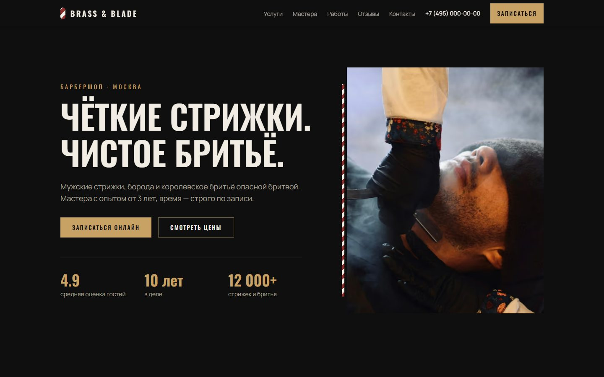
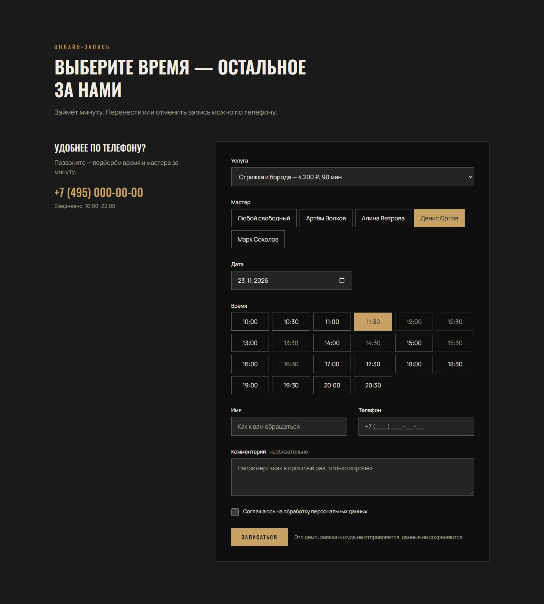
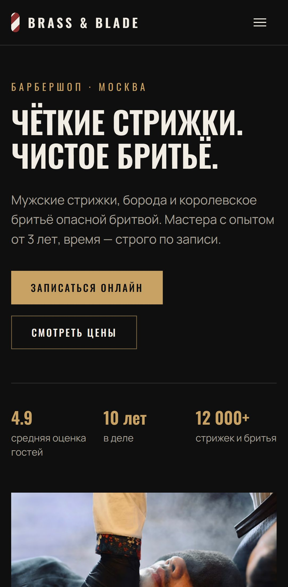
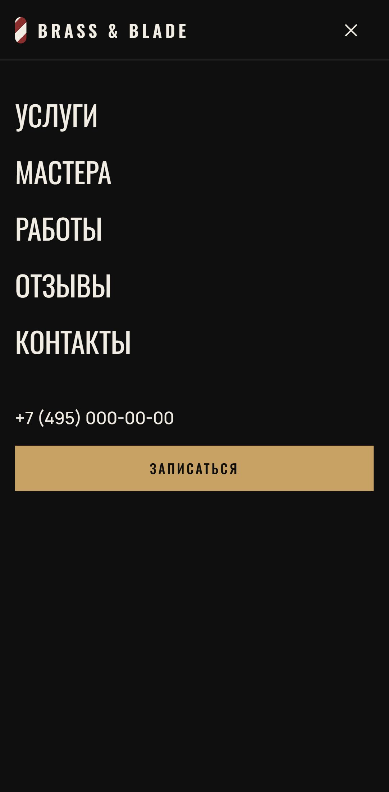

# Brass & Blade — лендинг барбершопа

**Сайт:** https://grozeser.github.io/barbershop-landing/

Одностраничный сайт барбершопа с онлайн-записью. Концепт для портфолио: бизнес, мастера, адрес
и отзывы вымышленные.



| Онлайн-запись                                         | Телефон                                           | Меню на телефоне                                    |
| ----------------------------------------------------- | ------------------------------------------------- | --------------------------------------------------- |
|  |  |  |

## Что внутри

- **Онлайн-запись:** услуга → мастер → дата → свободное время → контакты. Слоты строятся с учётом
  длительности услуги и часов работы, прошедшее время скрыто, занятое зачёркнуто. Маска телефона,
  понятные ошибки под полями, фокус на первую ошибку, экран «Вы записаны».
- **Предвыбор:** «Записаться» у услуги или мастера сразу подставляет их в форму.
- **Галерея работ** с просмотром в `<dialog>`: стрелки, Esc, клик по фону, возврат фокуса.
- **Адаптивность** от 320 px: мобильное меню на Popover API, плавающая кнопка записи, которая
  прячется, когда на экране уже есть своя.
- **Анимации** появления при прокрутке, отключаются при `prefers-reduced-motion`.
- **SEO:** canonical, Open Graph с превью 1200×630, schema.org `HairSalon`, sitemap.

## Качество

| Что                           | Результат                                                         |
| ----------------------------- | ----------------------------------------------------------------- |
| Lighthouse, мобильный профиль | Performance 98 · Accessibility 100 · Best Practices 100 · SEO 100 |
| Core Web Vitals (лаб.)        | LCP 2.0 с · CLS 0.01 · TBT 40 мс                                  |
| Доступность                   | WCAG 2.2 AA: axe без нарушений + ручной аудит                     |
| Юнит-тесты (Vitest)           | 16 — слоты, даты, маска и проверка телефона, валидация            |
| E2E (Playwright)              | 10 — десктоп и Pixel 7, с проверкой axe                           |
| JavaScript на странице        | ~10 КБ                                                            |

CI на каждый пуш: проверка типов, юнит-тесты, Prettier, e2e. Сайт выкладывается на GitHub Pages
только если всё зелёное.

## Стек и решения

- **Astro 7 + Tailwind CSS 4.** На выходе статический HTML; интерактив — несколько небольших
  скриптов на TypeScript без фреймворка.
- **Логика записи — чистые функции** в [`src/lib/booking.ts`](src/lib/booking.ts), поэтому
  покрыта юнит-тестами, а не только кликами в браузере.
- **Форма никуда не отправляет данные** и честно говорит об этом. У личных полей нет `name`:
  даже без JavaScript браузер не положит имя и телефон в адрес страницы.
- **Контент отделён от вёрстки:** цены, мастера, отзывы и тексты лежат в [`src/data`](src/data).
- **Фото через `<Picture>`:** AVIF/WebP нужного размера, ленивая загрузка, у главного фото —
  приоритет.
- **Без лишнего:** нет бэкенда, CMS, аналитики и сторонних виджетов.

Подробнее: [план и этапы](PLAN.md) · [дизайн-система](docs/design-system.md) ·
[чеклист релиза](docs/release-checklist.md) · [журнал работы](WORKLOG.md)

## Запуск

Нужен Node.js 22.23 или новее.

```bash
npm install
npm run dev
```

Сайт откроется на http://localhost:4321/barbershop-landing/.

| Команда            | Что делает                                        |
| ------------------ | ------------------------------------------------- |
| `npm run dev`      | Dev-сервер с горячей перезагрузкой                |
| `npm run build`    | Проверка типов, юнит-тесты и сборка в `dist/`     |
| `npm run preview`  | Локальный просмотр собранного сайта               |
| `npm test`         | Юнит-тесты в режиме наблюдения                    |
| `npm run test:e2e` | E2E по собранному сайту (сначала `npm run build`) |
| `npm run format`   | Prettier                                          |

Смоук-тест живого сайта: `BASE_URL=https://grozeser.github.io/barbershop-landing/ npm run test:e2e`.

## Структура

```
src/
├─ components/    секции страницы и ui/ (Button, Section, Badge, Field, Photo)
├─ data/          контент: услуги, мастера, отзывы, FAQ, тексты
├─ lib/           логика записи, форматирование, фото + тесты
├─ layouts/       Base.astro: мета-теги, Open Graph, JSON-LD
└─ styles/        Tailwind и токены дизайн-системы
tests/e2e/        Playwright + axe
docs/             дизайн-система, чеклист релиза, источники фото, скриншоты
```

## Фото

Снимки с [Unsplash](https://unsplash.com) по Unsplash License, авторы перечислены в
[docs/credits.md](docs/credits.md). Люди на фото не связаны с вымышленным барбершопом.
